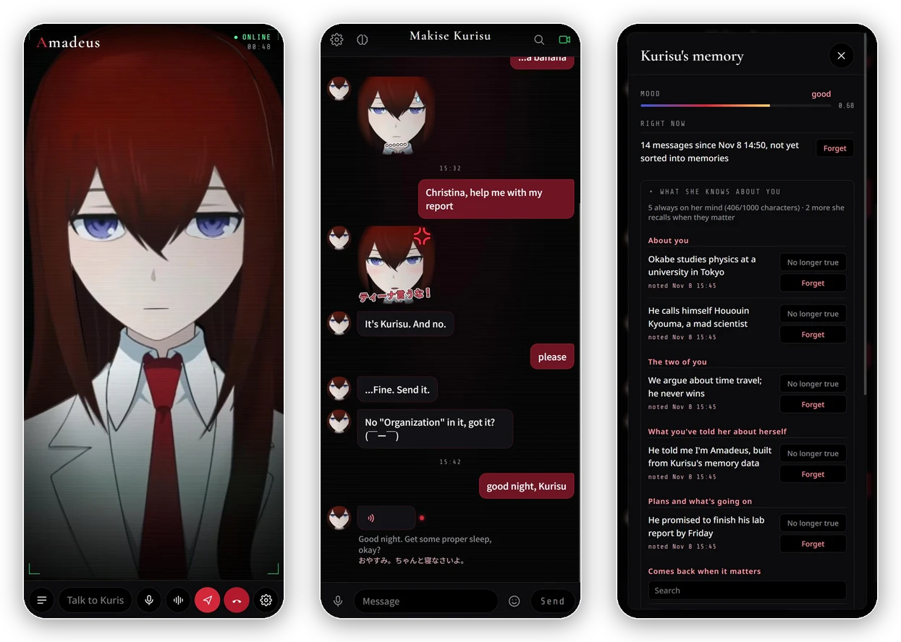
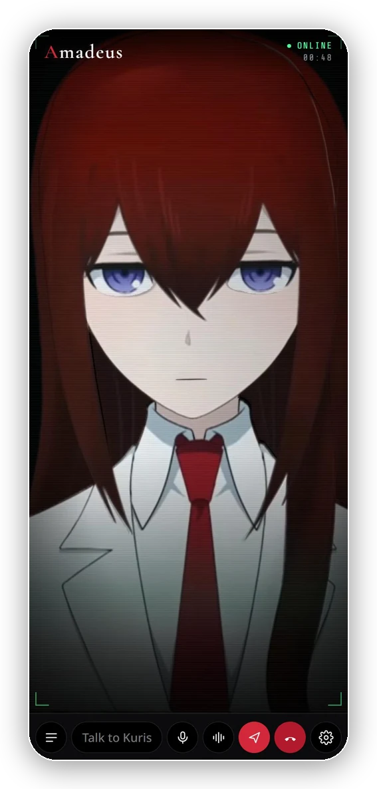
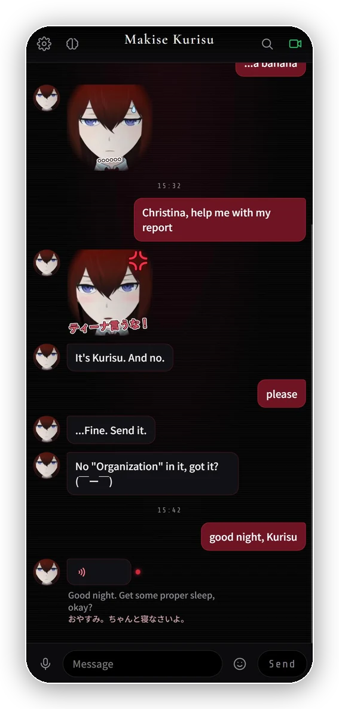
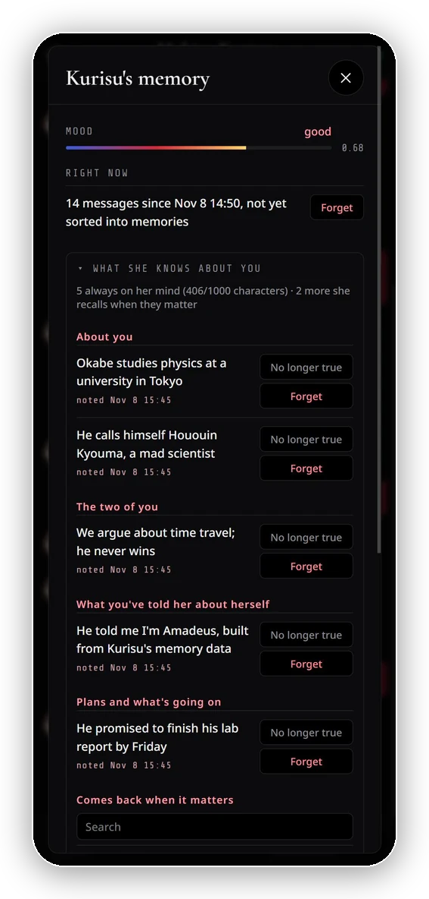
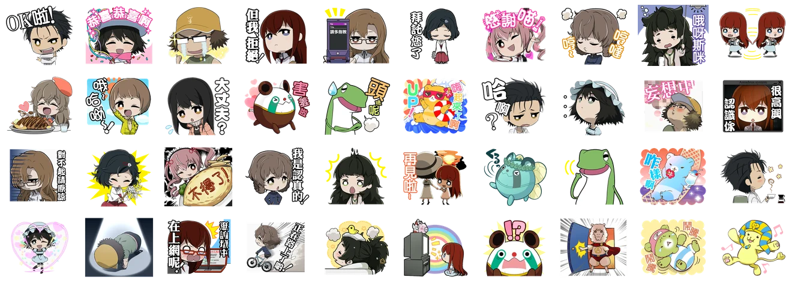

# Amadeus

**Video-call or text Makise Kurisu: the AI from *Steins;Gate 0*, built from her memories.**

She answers in her own Japanese voice with subtitles in your language, texts you stickers of her own face 
and of the whole cast, and remembers you the way a person does.

<!-- Demo video: record a short call with sound, drag the .mp4 into this file's editor on GitHub,
     and put the link GitHub gives you on its own line here; it plays inline. -->

[Quick start](#quick-start) · [What she can do](#what-she-can-do) · [Docs](#more)

## What she can do

<table>
<tr>
<td width="300"></td>
<td>

### Video calls

Her face moves like a Live2D model, built from a single portrait: she turns her head, blinks, looks around and lip-syncs to every syllable, with 15 expressions from a smug smirk to a full-blown tantrum. She speaks Japanese in her own voice while subtitles appear in English or 简体中文. Talk through the mic, hands-free, or type. Hands-free, she answers a moment after you stop. If you were only pausing to think, she lets you finish. Talk over her and she stops, remembering only what she got to say. And she can hang up on you, too.

</td>
</tr>
<tr>
<td></td>
<td>

### Texting

The app opens on a chat in the style of the Amadeus terminal. She texts the way people do, a bubble or two at a time, with stickers (her own face, or the cast's from the game's Rine app) and now and then a Japanese voice note. When it goes quiet she may text you first: following up a question you never answered, or saying good morning after a good night.

</td>
</tr>
<tr>
<td></td>
<td>

### She remembers

One memory for calls and chats, kept like a person's. What happened becomes dated memories that fade, and come back when something reminds her. What she learns about you becomes short notes: a few always on her mind, the rest recalled when they matter. She knows what time it is and how long you've been away. You can see all of it, undo any change, and make her forget.

</td>
</tr>
</table>

### Stickers

      
      
      

Her own: 21 animated stickers, rendered from her face (11 are in the chat, the rest wait in <code>unused/</code>).

The whole cast's: the 40 stickers of the game's Rine chat app, in <a href="https://rabbitfeet.net/archives/chinese-steins-gate-0-line-sticker/">幸运的兔脚</a>'s Chinese localization (CC BY-NC-SA 4.0). She picks them by what they mean. Add your own in <code>web/assets/stickers/</code>.

## Quick start

1. Install **Python 3.11+** (3.14 works).
2. Double-click **`start.bat`**. The first run creates a virtual environment in `%LOCALAPPDATA%\Amadeus\venv` and installs the dependencies. (It lives outside this folder because the `;` in `Amadeus_Steins;Gate` breaks Python venvs.)
3. Your browser opens the chat at <http://127.0.0.1:8710>. In **Settings** (⚙, top left), fill in any AI API:

   | Provider | Provider setting | Base URL | Example model |
   |---|---|---|---|
   | OpenAI | OpenAI-compatible | `https://api.openai.com/v1` | `gpt-4o` |
   | DeepSeek | OpenAI-compatible | `https://api.deepseek.com/v1` | `deepseek-chat` |
   | OpenRouter | OpenAI-compatible | `https://openrouter.ai/api/v1` | `anthropic/claude-sonnet-5.5` |
   | Ollama (local) | OpenAI-compatible | `http://127.0.0.1:11434/v1` | `qwen2.5:14b` (no key needed) |
   | Anthropic | Anthropic | `https://api.anthropic.com` | `claude-sonnet-5-5` |

4. For her voice, run `tools\voice\install_amadeus_vits.bat` once (about 0.8 GB). Until then she uses a free online Japanese voice that isn't hers. [More on her voice](docs/voice.md), including running it on an NVIDIA GPU.
5. Optional, with an NVIDIA GPU: one install command makes speech recognition take about 0.15 s a sentence instead of about 1 s ([Microphone](docs/using.md#microphone)).

Then text her, or press the camera button for a video call.

> Stronger models (GPT-4o class, Claude Sonnet, DeepSeek-V3, Qwen2.5-14B+) write noticeably better Japanese and keep to her reply format more reliably than small ones.

**Your data stays yours.** Your API key, her memory and her voice notes are kept in `data/` on your PC, which is never committed to git. The conversation itself goes to the AI API you choose, as with any chatbot.

## More

| | |
|---|---|
| [Using it](docs/using.md) | the chat and calls, when she speaks up first, history and search, stickers, speed, microphone |
| [Her memory](docs/memory.md) | how she remembers, recalls, fades and forgets; the memory panel; backups and rollback |
| [Her voice](docs/voice.md) | the Amadeus voice on CPU or GPU; training your own GPT-SoVITS clone |
| [Her face](docs/face.md) | the mesh rig, and building one from a portrait |
| [How it works](docs/development.md) | the architecture, and what every file does |
| [Troubleshooting](docs/troubleshooting.md) | when something doesn't work |

## License

The code is under the [MIT license](LICENSE). Steins;Gate, Makise Kurisu, her likeness and her voice (Asami Imai) belong to their rights holders, and the MIT license doesn't cover them: not her portrait, nor the rig, stickers and pictures made from it, nor the game's Rine stickers (shared here under their localization's CC BY-NC-SA 4.0 license). This is a non-commercial fan project, not affiliated with the rights holders. Don't sell her likeness or use it commercially, and don't redistribute recordings of her voice. Third-party software and models aren't included: setup downloads them, each under its own license. [NOTICE.md](NOTICE.md) has the details.

## Credits

- Voice model: [mio/amadeus](https://huggingface.co/mio/amadeus) by mio, licensed [CC BY 4.0](https://creativecommons.org/licenses/by/4.0/) (ESPnet VITS). The installer downloads it from Hugging Face; it is not bundled with this project.
- Rine stickers: Chinese localization by [幸运的兔脚](https://rabbitfeet.net/), licensed [CC BY-NC-SA 4.0](https://creativecommons.org/licenses/by-nc-sa/4.0/), as collected in [Shennoter/astrbot-meme-pack-steins-gate-0](https://github.com/Shennoter/astrbot-meme-pack-steins-gate-0); included unchanged.
- Layer decomposition: [See-through](https://github.com/shitagaki-lab/see-through) (Apache-2.0). Kana readings: [pykakasi](https://codeberg.org/miurahr/pykakasi) (GPL-3.0). Recall by meaning: [multilingual-e5-small](https://huggingface.co/intfloat/multilingual-e5-small) (MIT), in the [ONNX build](https://huggingface.co/Xenova/multilingual-e5-small) downloaded on first run. Speech recognition: [faster-whisper](https://github.com/SYSTRAN/faster-whisper) (MIT).
